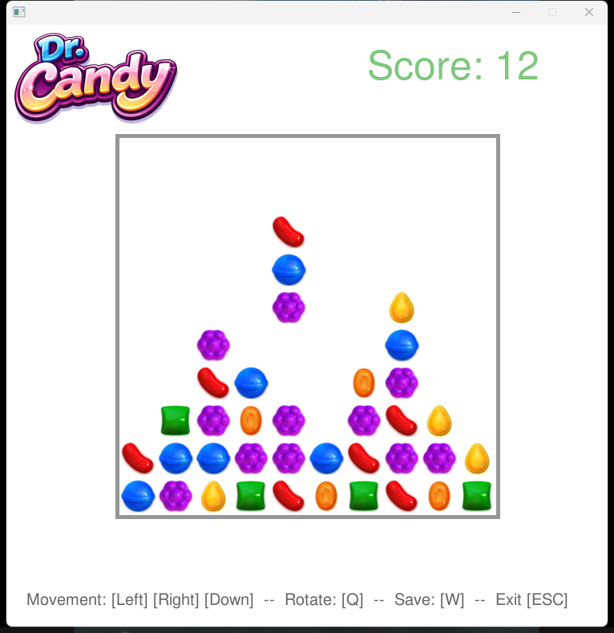

# Dr. Candy: falling-block match-3 puzzle in C++

A puzzle game that mixes **falling blocks** with **match-3** rules. Columns of three candies fall onto a 10 × 10 board. You move them sideways, cycle their order and drop them. When **three or more candies of the same colour line up horizontally, vertically or diagonally**, they explode, the candies above fall into the gap, and chain reactions can follow.

Written in **C++20** on top of SDL2.



<p align="center"><em>A game loaded from <code>data/saves/demo.txt</code></em></p>

## Controls

| Key | Action |
|---|---|
| ← / → | Move the falling column |
| ↓ | Drop faster |
| Q | Rotate (cycle) the three candies |
| W | Save the game to `data/save.txt` |
| Esc | Quit |

## What's inside

| File | Responsibility |
|---|---|
| `src/board.*` | 2D grid of `Candy*` with match detection (`shouldExplode`), cascades (`explodeAndDrop`), and `dump`/`load` to save files. It also implements `operator==` and `operator=` (deep copy). |
| `src/game.*` | Game loop logic: spawning, sideways collision, gravity on a frame timer, landing, scoring, game over, saving and loading the whole state. |
| `src/candy.*` | Candy types (`enum class CandyType`) and their sprites. |
| `src/controller.*` | Detects the frame on which a key is pressed, so holding a key doesn't repeat the action. |
| `test/test.cpp` | **19 unit tests** that run at start-up: board limits, constructor, getters and setters, explosion rules (horizontal, vertical, diagonal), cascades, equality, and save/load round-trips. |
| `src/private/` | SDL2 wrapper and third-party libraries, provided by the course. |

### Match detection and cascades

`Board::shouldExplode(x, y)` checks, for the candy at `(x, y)`, every 3-in-a-row window that contains it. In each direction (horizontal, vertical and both diagonals) the candy can be at the start, the middle or the end of the line. `explodeAndDrop()` then repeats these steps until the board is stable:

1. Mark every candy that should explode. All candies are marked first so that crossing lines explode together.
2. Remove the marked candies and add them to the score.
3. Apply gravity to each column, so candies fall into the empty cells.
4. Check again, because the falling candies can create new matches (chain reactions).

### Saving and loading

Pressing **W** writes the full game state to a plain-text file: score, flags, the falling block and the board. You can resume a saved game with:

```bash
CandyDrop data/save.txt          # Windows
./build/candy_drop data/save.txt # Linux/macOS
```

## Build & run

**Windows (Visual Studio 2022):** open `visual_studio/windows/CandyDrop.sln`, choose **Debug | x86** and press **F5**. You can also build from the command line:

```powershell
msbuild visual_studio\windows\CandyDrop.sln /p:Configuration=Debug /p:Platform=x86
.\run.bat
```

**Linux:**

```bash
sudo apt install build-essential cmake libsdl2-dev libsdl2-ttf-dev libsdl2-mixer-dev libsdl2-image-dev libsdl2-gfx-dev libpng-dev
make
./run.sh
```

For Fedora and macOS, see [docs/building.md](docs/building.md) (in Spanish).

## Project structure

```
candy-drop-puzzle/
├── src/                 # game code (board, game, candy, controller, graphics)
│   └── private/         # SDL2 wrapper + bundled libraries (course-provided)
├── test/                # unit tests
├── data/                # sprites, font, saved games
├── visual_studio/windows/  # VS solution + runtime DLLs (Program/)
├── docs/                # screenshot and per-platform build guide
├── CMakeLists.txt, Makefile, run.sh, run.bat
```

## Possible improvements

- [ ] **Manual memory management.** The board stores raw `Candy*` with `new`/`delete`. Using `std::vector<std::optional<Candy>>` or `std::unique_ptr` would remove leaks and simplify the copy operations.
- [ ] **Inconsistent indexing.** `getCell(fila, columna)` is called with `(x, y)` in some places. It works on square boards but would break on non-square ones.
- [ ] **No next-piece preview, levels or increasing speed yet.**

## Credits

This was the course project for **Programació II** (Computer Engineering, Universitat Autònoma de Barcelona, 2025-26).

- **Provided by the course:** the SDL2 graphics wrapper (`src/private/`), `graphics.*`, `controller.*`, the candy sprites and the logo.
- **Implemented by me:** `board.*`, `game.*` and the unit tests.
- **Added after the course:** loading a saved game from the command line, and a more robust lookup of the `data/` folder (`util.cpp`).

---

### 🇪🇸 Resumen en español

Juego de puzle en **C++** que mezcla piezas que caen con las reglas de **match-3**. Cuando se alinean tres caramelos del mismo color (en horizontal, vertical o diagonal), explotan y se producen reacciones en cadena. Se puede guardar y cargar la partida. Incluye 19 tests unitarios. Es el proyecto de la asignatura *Programació II* (UAB).
